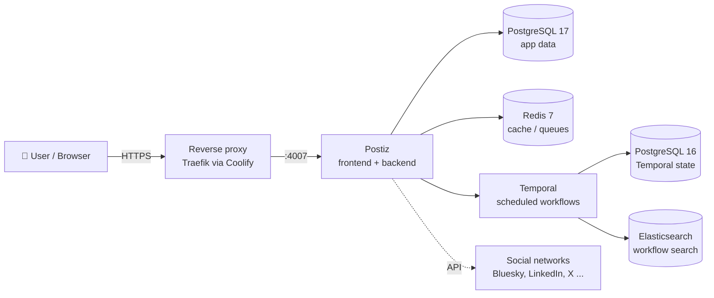

# Postiz Self-Hosted 🗓️


A production-minded setup for self-hosting **[Postiz](https://github.com/gitroomhq/postiz-app)**, an open-source social media scheduler, with Docker Compose.

I built this in two phases: first a **local test on Windows (Docker Desktop)**, then a **server deployment with Coolify** behind HTTPS on a custom domain.

---

## 📐 Architecture



| Service | Purpose | Exposed |
|---|---|---|
| `postiz` | Web UI + API | `127.0.0.1:4007` → reverse proxy |
| `postiz-postgres` | Application database | internal only |
| `postiz-redis` | Cache and queues | internal only |
| `temporal` + DB + Elasticsearch | Runs scheduled posts reliably | internal / localhost only |
| `temporal-ui` | Workflow monitoring | `127.0.0.1:8080` (SSH tunnel) |

---

## 🔐 What I changed compared to the official compose file

- **No secrets in Git**: all passwords, JWT secret and URLs come from `.env`; only `.env.example` is committed.
- **Fail fast**: compose refuses to start if a required secret is missing (`${VAR:?...}`).
- **Random secrets** generated by a script instead of default passwords.
- **Localhost-only ports**: Postiz, Temporal and Temporal UI listen on `127.0.0.1`, so only the reverse proxy is public.
- **Backups and restore** scripts for the database and uploaded media, with rotation.
- Removed unused provider variables to keep the config readable.

---

## 🧪 Phase 1 – Local test (Windows / Docker Desktop)

**Requirements:** Docker Desktop (WSL 2 backend), Git Bash or WSL, ~2 GB free RAM.

```bash
git clone https://github.com/shuvoece/postiz-self-hosted.git
cd postiz-self-hosted

./scripts/generate-secrets.sh     # creates .env with random secrets
docker compose up -d
docker compose ps                 # wait until all services are "healthy" (~2 min)
```

Open **http://localhost:4007** and create the first account.

> Tip: if a service keeps restarting, check it with `docker compose logs -f <service>`.

---

## 🚀 Phase 2 – Server deployment with Coolify

Short version (details in [`docs/coolify.md`](docs/coolify.md)):

1. Create a DNS **A record** for your subdomain (e.g. `postiz.example.com`) pointing to the server IP.
2. In Coolify: **New Resource → Docker Compose** from this Git repository.
3. Set the environment variables from `.env.example` in Coolify's UI, with `POSTIZ_URL=https://postiz.example.com`.
4. Assign the domain to the `postiz` service on port **5000**. Coolify (Traefik) requests the Let's Encrypt certificate.
5. Deploy, create the admin account, then set `DISABLE_REGISTRATION=true` and redeploy.

---

## 💾 Backup & restore

```bash
./scripts/backup.sh                          # DB dump + uploads, keeps last 7
./scripts/restore.sh backups/2026-10-26_03-00
```

Daily backup at 03:00 via cron:

```cron
0 3 * * * /opt/postiz-self-hosted/scripts/backup.sh >> /var/log/postiz-backup.log 2>&1
```

---

## 🔌 Connecting social channels

- **Bluesky** needs no API keys: in Postiz choose *Add channel → Bluesky* and log in with your handle and an **app password** (Bluesky → Settings → App passwords).
- **LinkedIn, X** etc. need a developer app; put the keys in `.env` and set the callback URL to `https://<your-domain>/integrations/social/<provider>`.

See the [official provider docs](https://docs.postiz.com/self-host/providers/overview.md).

---

## 🛠️ Useful commands

```bash
docker compose ps                       # status and health
docker compose logs -f postiz           # follow app logs
docker compose pull && docker compose up -d   # update images
ssh -L 8080:127.0.0.1:8080 user@server  # open Temporal UI at http://localhost:8080
```

---

## 📚 What I learned

<!-- Fill this in from your own experience – recruiters read this part! Examples: -->
- Why Postiz needs **Temporal** for reliable scheduling, and how its dependencies (Postgres, Elasticsearch) start in order using **healthchecks + `depends_on`**.
- Keeping secrets out of Git and binding admin ports to localhost.
- Postiz requires **HTTPS** in production because it uses secure cookies.
- _Add the problems you hit and how you solved them._

---

## 📄 Credits

Based on the official [gitroomhq/postiz-docker-compose](https://github.com/gitroomhq/postiz-docker-compose) (AGPL-3.0). Postiz is developed by [Gitroom](https://github.com/gitroomhq/postiz-app).
